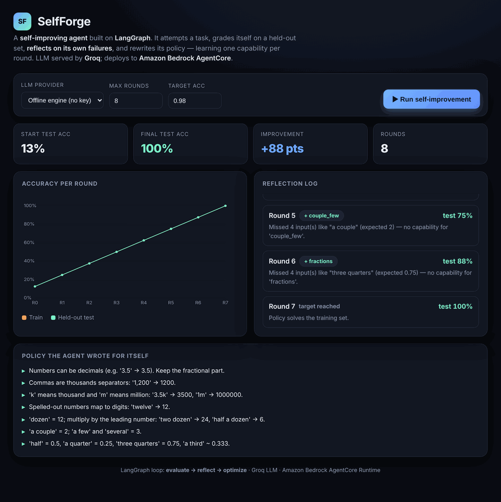
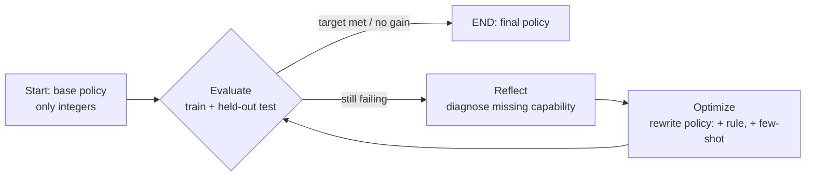
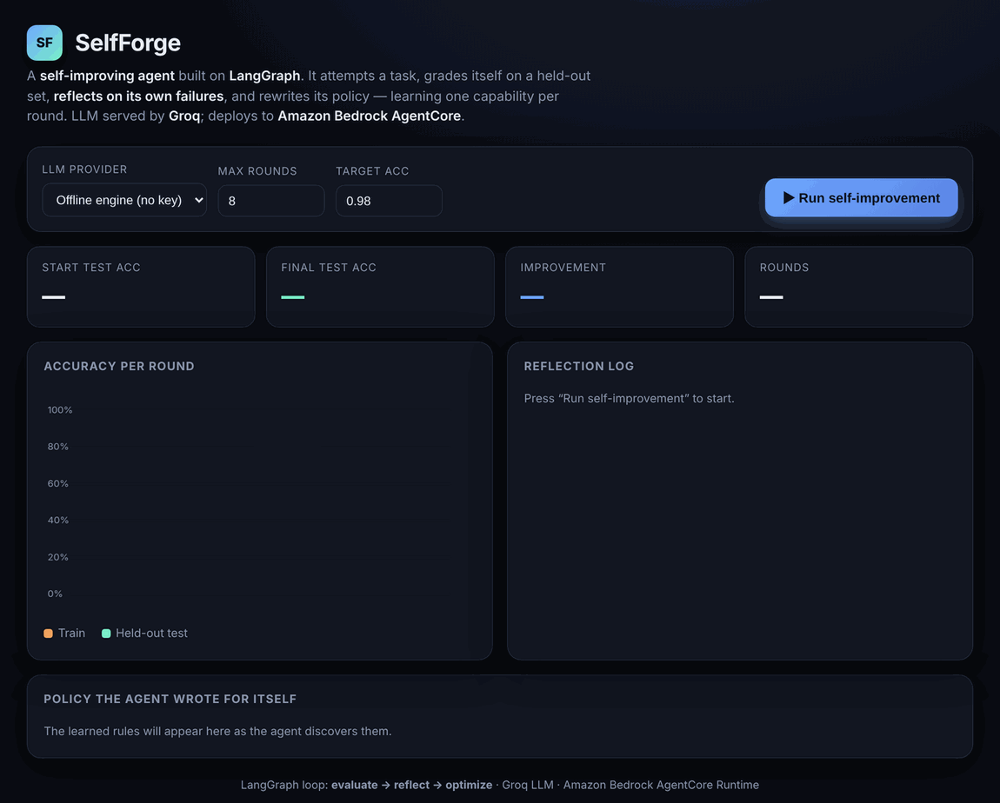
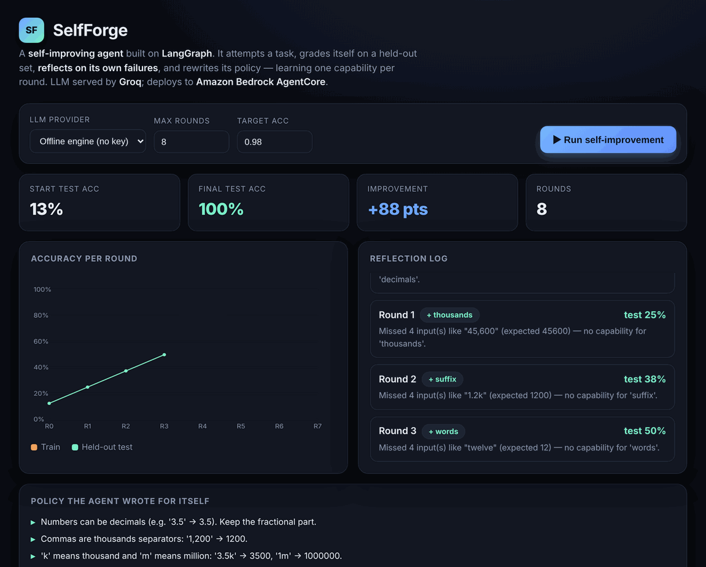

# Aws_langchain_self_improving_agent

> **SelfForge** — a self-improving agent built on **LangGraph** that attempts a task, grades
> itself on a held-out set, **reflects on its own failures, and rewrites its own policy** —
> learning one new capability per round until it masters the task. The LLM is served by
> **Groq**, and the agent deploys to **Amazon Bedrock AgentCore Runtime**.

<p align="center">
  
</p>

In the run above the agent goes from **13% → 100%** held-out-test accuracy in 8 rounds, with
**no human tuning** — every rule in the final policy was written by the agent itself after
reflecting on what it got wrong.

---

## Why this is interesting

Most "agent" demos just wire an LLM to some tools. This one implements the **Reflexion /
self-refine** pattern as a real control loop:

1. **Evaluate** the current policy on a train + held-out test split.
2. **Reflect** on the failures — diagnose *which capability is missing*.
3. **Optimize** — rewrite the policy (new instruction + a worked few-shot example) and enable
   the capability.
4. Loop until the target accuracy is met or no further improvement is possible.

The result is a **measurable self-improvement curve**, not a vibe. The whole loop runs
**offline and deterministically** (no API key) so tests, CI and the demo are fully
reproducible; flip one flag to run it against a **real Groq LLM**.

---

## Architecture



| Layer | What it does | File |
|-------|--------------|------|
| **LangGraph loop** | `evaluate → reflect → optimize` state machine | `src/selfforge/agent.py` |
| **Optimizer** | diagnoses failures, writes new policy | `src/selfforge/optimizer.py` |
| **LLM providers** | Groq (real) or offline deterministic engine | `src/selfforge/llm.py`, `engine.py` |
| **Task / dataset** | quantity-phrase normalization, stratified split | `src/selfforge/dataset.py` |
| **Web UI** | FastAPI app that animates the run | `src/selfforge/api.py`, `web/index.html` |
| **AgentCore entrypoint** | `POST /invocations`, `GET /ping` on :8080 | `src/selfforge/agentcore_app.py` |

---

## Walkthrough (each step)

### 1. Start — an agent that only knows integers



The agent begins with a single capability (`integers`). On the held-out set that's ~13%.
You choose the LLM provider (offline engine or **Groq llama-3.3-70b**), the round budget and
the target accuracy.

### 2. Running — reflect and learn, one capability per round



Each round the **reflection log** shows the diagnosis — e.g. *"Missed 4 inputs like 'two
dozen' (expected 24) — no capability for 'dozen'"* — and the chip (`+ dozen`) shows the rule
the agent just taught itself. The accuracy line climbs as capabilities accumulate.

### 3. Result — 100% held-out accuracy, policy written by the agent


The agent converges to **100%** and prints the **policy it wrote for itself** — the full set
of rules it discovered, in plain language, ready to drop into a real LLM's system prompt.

---

## Quickstart

```bash
pip install -r requirements.txt

# A) See the app (visual UI) — no API key needed
PYTHONPATH=src uvicorn selfforge.api:app --port 8080
# open http://localhost:8080

# B) From the terminal
PYTHONPATH=src python -m selfforge.cli run --provider offline

# C) With a real Groq LLM
export GROQ_API_KEY=gsk_...            # from https://console.groq.com/keys
PYTHONPATH=src python -m selfforge.cli run --provider groq
```

Example CLI output:

```
          SelfForge · offline-deterministic
┏━━━━━━━┳━━━━━━━┳━━━━━━┳━━━━━━━┳━━━━━━━━━━━━━┓
┃ Round ┃ Train ┃ Test ┃ Rules ┃ Learned     ┃
┡━━━━━━━╇━━━━━━━╇━━━━━━╇━━━━━━━╇━━━━━━━━━━━━━┩
│   0   │  12%  │ 13%  │   1   │ decimals    │
│   …   │   …   │  …   │   …   │ …           │
│   7   │ 100%  │ 100% │   8   │ —           │
└───────┴───────┴──────┴───────┴─────────────┘
13% → 100% held-out test  (+88 pts)
```

---

## Deploy to Amazon Bedrock AgentCore

The agent packages to the AgentCore Runtime contract (a container serving `POST /invocations`
and `GET /ping` on port 8080 — provided by the `bedrock-agentcore` SDK in
[`agentcore_app.py`](src/selfforge/agentcore_app.py)).

```bash
pip install bedrock-agentcore-starter-toolkit

agentcore configure -e src/selfforge/agentcore_app.py --name selfforge
agentcore launch --env GROQ_API_KEY=$GROQ_API_KEY      # builds ARM64 image, pushes to ECR, deploys
agentcore invoke '{"action":"improve","provider":"groq"}'
```

Config lives in [`.bedrock_agentcore.yaml`](.bedrock_agentcore.yaml). `GROQ_API_KEY` is passed
to the runtime at launch (or via AWS Secrets Manager) — **never committed**.

---

## Tests

```bash
PYTHONPATH=src pytest -q      # 8 passed — proves the agent genuinely improves and converges
```

Among other things the suite asserts the curve is **monotonic non-decreasing** and that the
final held-out accuracy clears the target — i.e. the self-improvement is real, not scripted.

---

## Tech stack

**LangGraph** · **LangChain** · **Groq** (llama-3.3-70b) · **Amazon Bedrock AgentCore** ·
**FastAPI** · **Pydantic** · **Docker** · **GitHub Actions**

## License

MIT © Arash Omranpour
